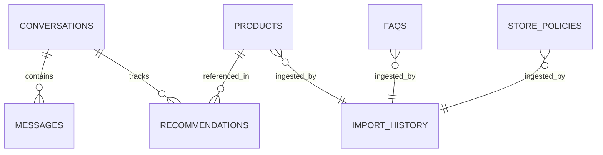

# Data Model: VoltKart AI Agent

**Database Name**: `voltkart_db`  
**Storage Engine**: MongoDB  
**Driver**: PyMongo 4.x  

---

## Collections & Schemas

### 1. `products`
Stores laptop specifications, pricing, and hardware metadata.

```json
{
  "_id": "ObjectId",
  "product_id": "string (unique, e.g. 'VK-LAP-001')",
  "name": "string (e.g. 'VoltBook Pro 15')",
  "brand": "string (e.g. 'VoltKart', 'Lenovo', 'HP', 'Dell', 'Asus', 'Apple')",
  "price": "number (in INR, e.g. 54999.0)",
  "processor": "string (e.g. 'Intel Core i5 12th Gen')",
  "ram": "string (raw, e.g. '16GB DDR4')",
  "ram_gb": "integer (normalized, e.g. 16)",
  "storage": "string (raw, e.g. '512GB NVMe SSD')",
  "storage_gb": "integer (normalized, e.g. 512)",
  "display": "string (e.g. '15.6 inch FHD IPS 144Hz')",
  "graphics": "string (e.g. 'Intel Iris Xe' or 'NVIDIA RTX 3050 4GB')",
  "weight": "string (raw, e.g. '1.65 kg')",
  "weight_kg": "number (normalized, e.g. 1.65)",
  "battery_life": "string (raw, e.g. '8 Hours')",
  "battery_hours": "number (normalized, e.g. 8.0)",
  "warranty": "string (e.g. '1 Year Onsite Warranty')",
  "usage_type": "string ('student' | 'coding' | 'gaming' | 'business' | 'general')",
  "specifications": "object (arbitrary extra key-value pairs)",
  "content_hash": "string (MD5 hash for deduplication)",
  "source_file": "string (e.g. 'sample_products.csv')",
  "created_at": "ISODate",
  "updated_at": "ISODate"
}
```

**Indexes**:
- `product_id`: Unique index (`{"product_id": 1}`, `unique=True`)
- `price`: Ascending index (`{"price": 1}`)
- `brand`: Ascending index (`{"brand": 1}`)
- `usage_type`: Ascending index (`{"usage_type": 1}`)
- Compound Filter Index: `{"usage_type": 1, "price": 1}`
- Compound Brand-Price: `{"brand": 1, "price": 1}`

---

### 2. `faqs`
Stores frequently asked questions and official answers.

```json
{
  "_id": "ObjectId",
  "faq_id": "string (unique, e.g. 'FAQ-001')",
  "category": "string (e.g. 'Returns', 'Warranty', 'Payment', 'Shipping', 'Support')",
  "question": "string",
  "answer": "string",
  "keywords": ["string", "string"],
  "content_hash": "string",
  "source_file": "string",
  "created_at": "ISODate"
}
```

**Indexes**:
- `faq_id`: Unique index (`{"faq_id": 1}`, `unique=True`)
- `category`: Ascending index (`{"category": 1}`)
- Text Index: `{"question": "text", "keywords": "text"}`

---

### 3. `store_policies`
Stores official store policy articles.

```json
{
  "_id": "ObjectId",
  "policy_id": "string (unique, e.g. 'POL-001')",
  "category": "string ('return' | 'refund' | 'warranty' | 'shipping' | 'general')",
  "title": "string (e.g. 'Standard 7-Day Return Policy')",
  "description": "string (full policy terms)",
  "keywords": ["string", "string"],
  "content_hash": "string",
  "source_file": "string",
  "created_at": "ISODate"
}
```

**Indexes**:
- `policy_id`: Unique index (`{"policy_id": 1}`, `unique=True`)
- `category`: Ascending index (`{"category": 1}`)
- Text Index: `{"title": "text", "description": "text", "keywords": "text"}`

---

### 4. `conversations`
Tracks multi-turn customer chat sessions.

```json
{
  "_id": "ObjectId",
  "conversation_id": "string (UUID v4)",
  "title": "string (e.g. 'Student laptop under 60k')",
  "created_at": "ISODate",
  "updated_at": "ISODate"
}
```

**Indexes**:
- `conversation_id`: Unique index (`{"conversation_id": 1}`, `unique=True`)
- `updated_at`: Descending index (`{"updated_at": -1}`)

---

### 5. `messages`
Stores individual chat turns within a conversation.

```json
{
  "_id": "ObjectId",
  "conversation_id": "string (references conversations.conversation_id)",
  "role": "string ('user' | 'assistant')",
  "content": "string",
  "intent": "string ('recommend' | 'support' | 'compare' | 'out_of_scope' | 'fallback' | 'general')",
  "retrieved_record_ids": ["string (e.g. 'VK-LAP-001', 'FAQ-002')"],
  "created_at": "ISODate"
}
```

**Indexes**:
- Compound Session Index: `{"conversation_id": 1, "created_at": 1}`

---

### 6. `recommendations`
Maintains ordinal positions of recommended products per turn to support follow-up relative queries (e.g., "compare the first two").

```json
{
  "_id": "ObjectId",
  "conversation_id": "string (references conversations.conversation_id)",
  "product_id": "string (references products.product_id)",
  "position": "integer (1, 2, or 3)",
  "recommendation_reason": "string",
  "created_at": "ISODate"
}
```

**Indexes**:
- Compound Position Index: `{"conversation_id": 1, "position": 1}`
- Timestamp: `{"created_at": -1}`

---

### 7. `import_history`
Maintains audit logs for dataset uploads by administrators.

```json
{
  "_id": "ObjectId",
  "filename": "string",
  "dataset_type": "string ('products' | 'faqs' | 'policies')",
  "total_records": "integer",
  "inserted_records": "integer",
  "updated_records": "integer",
  "skipped_duplicates": "integer",
  "failed_records": "integer",
  "import_status": "string ('completed' | 'partial' | 'failed')",
  "error_log": ["string"],
  "imported_at": "ISODate"
}
```

**Indexes**:
- `imported_at`: Descending index (`{"imported_at": -1}`)

---

## Entity Relationships Diagram


